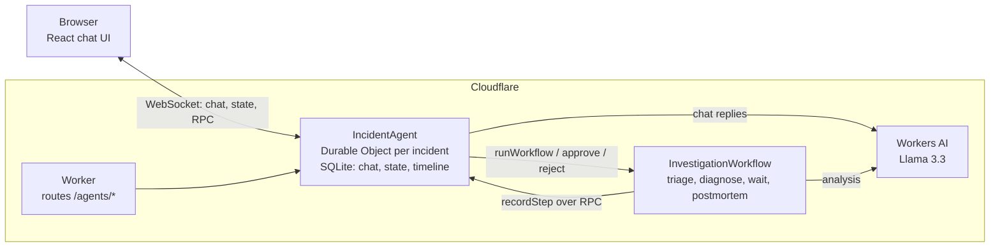

# Incident Copilot

An AI assistant for on-call engineers dealing with database incidents, built on Cloudflare.

You describe a problem in chat and paste evidence such as `pg_stat_activity` or `SHOW REPLICA STATUS` output. When you start an investigation, a durable workflow triages the incident, ranks likely root causes and proposes a fix. It then pauses until a human approves or rejects that fix. If approved, it drafts a blameless postmortem.

The app gives advice only. It has no connection to any database, and approving a fix just records the decision. Three invented sample incidents are included, so you can try it without a real outage.

## Architecture



| File | Purpose |
| --- | --- |
| `src/agent.ts` | The Durable Object: chat, state, timeline and the approval methods |
| `src/workflow.ts` | The durable investigation pipeline |
| `src/prompts.ts` | Every prompt sent to the LLM |
| `src/analysis.ts` | Pure logic: output validation and input size limits (unit tested) |
| `src/shared.ts` | Types shared by the Worker and the browser |
| `src/server.ts` | Worker entry point |
| `src/client/` | React UI and sample incidents |

## How each required component is met

| Component | Implementation | Where |
| --- | --- | --- |
| **LLM** | Llama 3.3 on Workers AI (`@cf/meta/llama-3.3-70b-instruct-fp8-fast`), for streaming chat and for the analysis steps | `src/agent.ts`, `src/workflow.ts` |
| **Workflow / coordination** | Cloudflare Workflows, using the Agents SDK's `AgentWorkflow`. Has retried steps and a human approval gate | `src/workflow.ts` |
| **User input** | Chat over WebSocket, using `AIChatAgent` and `useAgentChat`. The UI is served as static assets from the same Worker, rather than from Pages, so there is one deployable | `src/client/App.tsx` |
| **Memory / state** | One SQLite-backed Durable Object per incident, holding chat history, current state and an append-only timeline. The chat reads the investigation's findings when it replies | `src/agent.ts` |

## Key design decisions

**One Durable Object per incident.** An incident is a natural unit of state and of consistency. The `?incident=` value in the URL names the object, so a link reopens that incident's full history.

**Durable Object and Workflow have separate jobs.** The Durable Object owns the state and talks to browsers. The Workflow owns the long-running process, and it can wait for hours without using compute. A Workflow can't hold a WebSocket, so it reports results to the agent, which syncs them to clients.

**The LLM can't approve anything.** The model has no tools. Only the UI buttons start an investigation or decide on a fix, and those call `@callable` methods that check the current phase. Text in a pasted log therefore can't trigger an action, even if it manages to influence what the model says.

**Invalid LLM output is treated as a retryable failure.** Each response is validated against a Zod schema inside `step.do()`. If validation throws, the Workflow calls the model again with backoff. This happened during testing: a diagnosis returned invalid JSON twice and succeeded on the third attempt.

**Writes tolerate retries.** A step can run again if it fails after its write has committed. Timeline rows therefore have a fixed key and use `INSERT OR IGNORE`, and applying the same state patch twice is harmless. Writes from an older investigation are ignored, because each one carries its instance ID.

**Browsers can't write state.** The SDK allows client state updates by default, so `validateStateChange` rejects anything that doesn't come from the server.

**Evidence is a snapshot of what the user wrote.** It is copied into the Workflow's parameters when the run starts, so all steps and retries see the same input. Assistant replies are left out, so the model's earlier guesses can't come back as facts.

**A timeline table alongside state.** Agent state is rewritten in full on every change and synced to all clients, so it holds only current results. The timeline grows over time, so it has its own SQL table.

## Limitations

- **There is no authentication.** Anyone with a deployed URL can use the app and spend your Workers AI allocation, and anyone with an incident link can read it and approve fixes. A real deployment would need something like Cloudflare Access, and would record who approved each fix.
- **The model's advice can be wrong.** In testing, Llama 3.3 suggested a MySQL command (`SHOW PROCESSLIST`) for a Postgres incident, and queries using an outdated column name. It can also understate risk. This is the main reason for the human approval step, and every suggestion needs an engineer's review.
- **Pasted evidence goes to the LLM.** Remove credentials and customer data before pasting real logs.
- **Input is size-limited.** The model has a 24,000-token context window, so the oldest text is dropped from long inputs.

## Run it locally

You need Node.js and a Cloudflare account with a registered `workers.dev` subdomain. Durable Objects and Workflows run on your machine, but Workers AI has no local simulation, so **LLM calls go to Cloudflare and count as usage even in local development**.

```sh
npm install
npx wrangler login
npm run dev
```

Open http://localhost:5173, load a sample, send it, and click **Start investigation**.

To see the timeout path, create a `.dev.vars` file containing `APPROVAL_TIMEOUT="15 seconds"` and restart.

## Test

```sh
npm test            # unit tests, no Cloudflare account needed
npm run typecheck
```

The unit tests cover output validation and the input size limits. The rest was checked by hand against the real model in local development:

| Scenario | Result |
| --- | --- |
| Chat streams a reply from Llama 3.3 | Worked |
| Investigate, approve, draft postmortem | Worked |
| Reject a fix | Recorded as rejected, not failed, with no postmortem |
| No decision before the timeout | Recorded as timed out |
| Model unavailable (a deliberately invalid model ID) | Retries, then shows the failure and allows another attempt |
| Invalid JSON from the model | Recovered through Workflow retries |
| Reload the page, and restart the server | History and results restored |
| Double-click Approve | The second click is refused |
| Forged state update sent from a browser | Rejected by the server |

## Deploy

```sh
npm run deploy
```

This creates a public `workers.dev` URL with no authentication (see [Limitations](#limitations)).

Workers AI, SQLite-backed Durable Objects and Workflows are all available on the Workers Free plan. Workers AI includes 10,000 Neurons a day, and the Free plan can't be charged for more. The Free plan also has a limit of 10 ms of CPU time per invocation.

## How AI was used

This project was built with AI assistance, and [PROMPTS.md](PROMPTS.md) records how.
